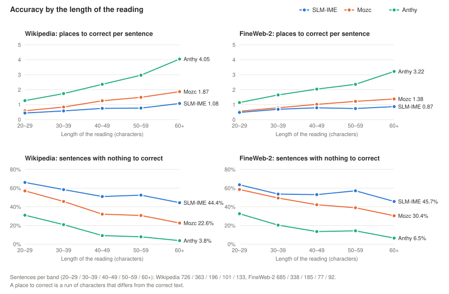

# fcitx5-slm-ime

A Japanese kana-to-kanji input method editor (IME) powered by a small language model (SLM): a character-level
Transformer (encoder-decoder) of about 60 million parameters that converts hiragana into kanji-kana text. The model
is small enough to run on a CPU only; no GPU is needed. It runs on Linux, on top of fcitx5.


Conventional Japanese input methods first cut the typed hiragana into words with a morphological analyzer, and choose
the kanji using that cut. However, a correct cut requires understanding the meaning of the whole sentence, and
understanding the meaning of the whole sentence requires a correct cut: there is a circular dependency.

This program avoids this problem by using a small language model directly: the small language model reads the typed
hiragana and writes the kanji-kana text together with the phrasal unit (bunsetsu) boundaries in one pass, with no
separate morphological analyzer.


## Version 1 and version 2

The aim is that anyone can install this program from their distribution, as Debian and Fedora packages. Such packages
may use only the libraries that the distribution provides. Version 1 computed the model in a server written in Java,
with a library (DJL) that the distributions do not provide, so its package had to carry DJL, PyTorch and a Java
runtime of its own. Version 2 computes the same model inside the engine, in C++ with Eigen, which every distribution
provides. The functions are the same.

## How it works

```
application (editor, browser, ...)
    |  keys typed by the user, the text before the cursor
    v
fcitx5
    |  key events, the text before the cursor (SurroundingText)
    v
SLM IME engine (llm-ime.so, loaded into the fcitx5 process)
    |-- romaji -> hiragana: the reading, shown in the preedit
    `-- converter (in the same process)
          |-- Transformer model   <- /usr/share/slm-ime/model (slm-ime-weights.bin, tokenizer.json)
          |-- Anthy               dictionary candidates of a phrasal unit
          `-- the user's choices  <-> ~/.local/share/slm-ime/user_history.tsv
    |
    v
fcitx5 -> application: the preedit, the candidate window and the committed text
```

1. While the user types, the engine turns the romaji into hiragana and shows it in the preedit.
2. When the user presses the convert key, the engine takes the text before the cursor from the application through
   fcitx5. If the application does not provide it, the engine takes the text the user committed before in the same
   input field. The engine gives the converter the reading and the last 100 characters of that text.
3. The converter gives both to the model, and the model writes the kanji-kana text with `|` between the phrasal units
   (bunsetsu). The converter finds the reading of each phrasal unit, and puts in the user's earlier choice where the
   same reading was corrected before. It returns the phrasal units to the engine, which shows them.
4. When the user moves to a phrasal unit to change it, the engine asks the converter for its candidates. The
   converter returns the user's earlier choice, the model's text, then the candidates of Anthy, which the model puts
   in order after the text before the phrasal unit.
5. When the user commits, the engine sends the text to the application through fcitx5. It records each phrasal unit
   the user changed in `user_history.tsv`.

## Accuracy

We compared the conversion with Mozc and Anthy on sentences of the Japanese Wikipedia and of FineWeb-2 (text of web
pages) that were not used for training and whose readings passed the check of "Clean the readings". Every example is a
stretch of a sentence as a user types it: the reading of a few phrasal units (bunsetsu), with the text before the
cursor. Mozc and Anthy are given the reading only; this program is also given the text before the cursor. Short
readings are converted correctly by every system, so the chart shows the readings of 20 characters or more, by
length.



A place to correct is a run of characters where the output differs from the correct text. The upper charts count
them per sentence; the lower charts show the share of the sentences with nothing to correct. The longer the reading,
the larger the difference: of the Wikipedia readings of 60 characters or more, this program converts 44 % without a
place to correct, Mozc 23 % and Anthy 4 %.

The training set has about 5.3 million examples, about half from each source: 2.4 million from the Japanese
Wikipedia and 2.9 million from FineWeb-2. The model has about 60 million parameters.
The correct texts are the original sentences. Their readings were written by Gemma 4, a large language model that
needs GPUs, and the obvious errors were corrected by post-processing. The ideal for this program is the accuracy of
Gemma 4 with this correction, on a PC without a GPU.

## Speed

The model is computed on the CPU alone. On a mini PC, the ASUS MINIPC PN51-S1 (AMD Ryzen 7 5700U, 8 cores, 16 threads,
32 GB of DDR4-3200 memory, no GPU), a conversion takes 91 ms on average, 86 ms in the middle and 247 ms at most, on
100 phrasal units of FineWeb-2 text. On an arm64 machine, the NVIDIA DGX Spark (20 cores), it takes 67 ms on average,
62 ms in the middle and 236 ms at most. The wait is not noticeable in use.

## Integration of Anthy for the alternative kanji

Once the SLM has decided the kanji-kana text and the phrasal units (bunsetsu), choosing among alternative kanji for
one phrasal unit is a well-defined job, and Anthy (`libanthy`) is exactly the right tool for it. Anthy is installed
together with this program and called from inside the engine, so the user does not set it up and does not
have to be aware of it. Choosing alternative kanji is the only job of Anthy: given the reading of one phrasal unit, it
reliably returns the alternative kanji. It is simple and robust, and it has done its work for many years. There is
nothing to improve by replacing something that already does its job this well, so this program does not reimplement
it; it relies on it. The SLM decides the phrasal units and gives the first candidate; Anthy supplies the other
candidates that the user steps through with the Space key. The order of the candidates for a phrasal unit is: what the
user chose before for the same reading, the SLM's answer, and then Anthy's candidates, which the SLM puts in order by
how likely it finds each of them after the text before the phrasal unit. Because Anthy has a dictionary,
it also reaches rare words, single kanji and proper nouns that a small model is weak at.

## Install with the Debian packages

Built for Ubuntu 24.04 and Debian 13; the Ubuntu 24.04 package also installs on Ubuntu 26.04. The program consists
of two Debian packages, each of which declares the packages that it
needs:

- `fcitx5-slm-ime`, the engine that runs inside `fcitx5`, with the conversion
- `slm-ime-model`, the weights and the tokenizer of the model

External components that the packages depend on, which `apt` installs:

- `fcitx5`, the input method framework, with `fcitx5-data`, `fcitx5-modules` and the `libfcitx5` libraries
- Anthy (`libanthy1t64`) with its dictionary (`anthy-common`)

`apt` installs the declared packages by itself. But these two packages are on GitHub Releases and not in an `apt`
repository, so `apt` can find `slm-ime-model` only if its file is named on the command line. The release has
`fcitx5-slm-ime` for two distributions, Ubuntu 24.04 (`~ubuntu24.04`) and Debian 13 (`~deb13`), each for two CPU
architectures, `amd64` and `arm64`, and one `slm-ime-model` for all of them. `dpkg --print-architecture` prints the
architecture of the machine. Download the `fcitx5-slm-ime` file for the distribution and the architecture, and
`slm-ime-model`, from <https://github.com/oogasawa/fcitx5-slm-ime/releases> into one directory and run this command in
it (on Debian 13, `deb13` in place of `ubuntu24.04`):

```bash
sudo apt install ./fcitx5-slm-ime_*~ubuntu24.04_$(dpkg --print-architecture).deb ./slm-ime-model_*_all.deb
```

Then restart fcitx5 and add `SLM IME` to the input methods with `fcitx5-configtool`.

Upgrade from version 1: the same command removes `slm-ime-server`, the conversion server of version 1, which is no
longer needed. The history of the choices (`~/.local/share/slm-ime/user_history.tsv`) stays. Restart fcitx5 after
the upgrade, and log in again to stop the server of version 1 that may still be running.

## Install with the RPM packages

Tested on Fedora 44. The program consists of two RPM packages, each of which declares the packages that it needs:

- `fcitx5-slm-ime`, the engine that runs inside `fcitx5`, with the conversion
- `slm-ime-model`, the weights and the tokenizer of the model

External components that the packages depend on, which `dnf` installs:

- `fcitx5`, the input method framework
- Anthy (`anthy-unicode`) with its dictionary

The two packages are on GitHub Releases and not in a `dnf` repository, so both files are named on the command line.
The release has `fcitx5-slm-ime` for `x86_64` and one `slm-ime-model` for every architecture. Download the two
`.rpm` files from <https://github.com/oogasawa/fcitx5-slm-ime/releases> into one directory and run this command in
it:

```bash
sudo dnf install ./fcitx5-slm-ime-*.x86_64.rpm ./slm-ime-model-*.noarch.rpm
```

Then restart fcitx5 and add `SLM IME` to the input methods with `fcitx5-configtool`.

## Install from source

The engine needs fcitx5, CMake 3.16 or later, a C++20 compiler, Eigen 3.3 or later, Anthy (`anthy` or
`anthy-unicode`), `nlohmann-json` 3.2 or later and gettext.

```bash
# Ubuntu / Debian
sudo apt install fcitx5 libfcitx5core-dev libfcitx5config-dev libfcitx5utils-dev fcitx5-modules-dev \
                 nlohmann-json3-dev libeigen3-dev libanthy-dev gettext cmake g++ pkg-config
cmake -S engine -B build -DCMAKE_INSTALL_PREFIX=/usr -DCMAKE_BUILD_TYPE=Release
cmake --build build
(cd build && ctest)
sudo cmake --install build
```

Then put the model in `/usr/share/slm-ime/model` (or in the directory named by the environment variable
`SLM_IME_MODEL_DIR` of fcitx5): `slm-ime-weights.bin` and `tokenizer.json` from the release, or made from a checkpoint
as in "Export the model". Restart fcitx5 (`fcitx5 -r -d`) and add the input method in `fcitx5-configtool`.

```bash
base=https://github.com/oogasawa/fcitx5-slm-ime/releases/download/v2.0.0
curl -LO $base/slm-ime-model_2.0.0_all.deb
dpkg-deb -x slm-ime-model_2.0.0_all.deb model-root     # model-root/usr/share/slm-ime/model/
sudo cp -r model-root/usr/share/slm-ime /usr/share/
```

In a source install the engine is still named `llm-ime`, its former name.

## Keys

The keys are shown and changed in `fcitx5-configtool`: select SLM IME among the input methods and press the configure
button. Choose a profile (Default, MS-IME or ATOK) or change the keys one by one. The button next to "Table of the keys
of every profile" opens a table of the keys of every profile in a browser.

## Train

The model learns from rows of a reading and the kanji-kana text of that reading. The training data is not
distributed, so training starts from the Japanese Wikipedia: a large language model (Gemma 4) writes the reading and
the phrasal unit (bunsetsu) boundaries of its sentences, and the small model is trained to reproduce the original
sentence from the reading and the text before the cursor. Training has six parts. Each part reads the files that the part
before it wrote.

### Make the pairs from Wikipedia

A pair is a sentence as a reading and as kanji-kana text, both cut into phrasal units (bunsetsu) by `|`, and the
n-th unit of the reading answers the n-th unit of the kanji-kana text.

```bash
# 1. the prose paragraphs of the articles of the dump: one line "title TAB paragraph"
java -cp commons-compress.jar:commons-io.jar -Djdk.xml.maxGeneralEntitySizeLimit=0 -Djdk.xml.totalEntitySizeLimit=0 \
     wikipedia/WikiTextExtractor.java jawiki-latest-pages-articles.xml.bz2 > jawiki_text.tsv
# 2. chunk files wiki_<n>.tsv of 30 paragraphs each, the unit of the work in step 3
java wikipedia/WikiToChunks.java jawiki_text.tsv CHUNK_DIR
# 3. one worker takes chunks from a list (ORDER_FILE has one chunk path per line), has the language model write
#    the pairs, and leaves CHUNK_pairs.tsv; many workers can share one list (wikipedia/image/ is their image)
wikipedia/image/worker.sh BROKER_CHAT_URL TAG MODEL ORDER_FILE
```

Step 1 skips redirects and pages that are not articles, and removes the wiki markup with simple rules, which is
good enough for training text. In step 3 the workers run the workflow `wikipedia/image/kana-kanji-pairs.yaml` of
Turing workflow against an LLM server that is reached through the GPU broker of this project, so this step needs
such a server. `wikipedia/ReadingCheck.java` compares the readings of the pairs with two dictionaries and lists the
units that differ; it changes nothing.

### Clean the readings

```bash
python3 prep/clean_readings.py PAIRS_DIR CLEAN_DIR --kanjidic kanjidic2.xml.gz --jmdict jmdict_pairs.tsv \
        --checker ANTHY_DICTS/tools --workers 12
```

The language model gets some readings wrong (相互作用 read そうごさくよう, 来日 read らいにゅう). The script checks
every phrasal unit (bunsetsu) of the pairs with `bunsetsu_check.py` of Anthy-dicts
(<https://github.com/oogasawa/Anthy-dicts>): the reading must be made of the readings of its kanji in KANJIDIC2 or of
its words in JMdict and JMnedict (`jmdict_pairs.tsv` has one `reading TAB word` per line). A reading that fails is
replaced by the reading of Sudachi (`sudachipy` with `sudachidict_full`) for the same stretch of the sentence, if that
one passes; a sentence that neither explains is marked `skip` and is used only as the text before the cursor of the
next sentences. On the pairs of 2.0.0, 5.9 % of the phrasal units of Wikipedia and 3.3 % of those of FineWeb-2
failed, 94 % of them were replaced, and 2.9 % and 1.4 % of the sentences were marked `skip`.

### Make the training files

```bash
python3 prep/build_dataset_g.py CLEAN_DIR DATA_DIR --context-chars 100 --partial-end-percent 20 --hiragana-source
```

`CLEAN_DIR` holds the `*_pairs.tsv` files. `--hiragana-source` writes the katakana of the readings in hiragana, as the
user types them (the language model wrote most readings of katakana words in katakana). The script cuts each sentence the way a user types it, from left to
right: a row is the reading of a few phrasal units (bunsetsu) from a random place in a sentence, put after the last
100 characters of the text before it and the separator `SEP`, and the answer is the kanji-kana text of that reading
with `|` kept. In 20 % of the rows (`--empty-percent`) the text before the cursor is left empty, so that the model
also converts well in applications that do not tell what is before the cursor. `--partial-end-percent` adds a twin
of a training row whose reading stops inside the okurigana or particles at the end of the last unit (for example
`せいどがよ` for `せいどがよい`), as when the user has typed only a part of them. The script writes `DATA_DIR/train.tsv`, `valid.tsv` and `test.tsv` (1 % each for valid and test by
default). A whole chunk goes to one of the three, chosen by a hash of its file name, because the sentences of a chunk
come from neighbouring articles and rows of one chunk in different files would leak the test text into training.

### Train the model

```bash
python3 -u train.py --data-dir DATA_DIR --run-name NAME --epochs 8 --batch-size 64 \
        --d-model 512 --nhead 8 --enc-layers 6 --dec-layers 6 --d-ff 2048 --max-len 192
```

The options give the size of the Transformer (512 dimensions, 8 heads, 6 encoder layers, 6 decoder layers; about 60
million parameters) and the longest input in characters. If `DATA_DIR` has no `tokenizer.json`, the script builds the
character vocabulary from `train.tsv` and saves it there. The optimizer is AdamW with a one-cycle schedule of the
learning rate (`--lr`, 3e-4 by default). After every epoch the script saves `checkpoints/NAME/last.pt` and the weights of that
epoch as `epoch_NN.pt`, and it saves `best.pt` when the loss on `valid.tsv` is the lowest so far. The forward pass
runs in bfloat16 by default (`--amp bf16`). On an RTX 4080, one epoch of 5.4 million rows takes about 91 minutes.

### Export the model

```bash
python3 export_weights.py checkpoints/NAME/best.pt MODEL_DIR/slm-ime-weights.bin 100
cp DATA_DIR/tokenizer.json MODEL_DIR/
```

The engine computes the model in C++ and does not read a PyTorch checkpoint, so the script writes the weights in a
simple file of its own: a JSON header with the size of the model and the place of every tensor, then the tensors as
float32. `engine/test/model-check.cpp` compares the C++ computation with PyTorch on cases that
`eval/make_cpp_golden.py` writes from the same checkpoint. `MODEL_DIR` is the model directory of "Install from
source".

### Evaluate

```bash
python3 eval/greedy_check.py checkpoints/NAME DATA_DIR
```

The script converts the sentences of `test.tsv` with the checkpoint, in the same way as the engine (greedy
decoding), and prints the character error rate, the share of exact matches, the error rate of the `|` marks alone, and
a few examples. `eval/compare_cut.py` compares models, Mozc and Anthy on the same rows.

## License

The source code is licensed under the Apache License 2.0 (see `LICENSE`).

The training data (pairs of a reading and kanji-kana text) and the trained model are licensed under
the Creative Commons Attribution-ShareAlike 4.0 International license (CC BY-SA 4.0,
https://creativecommons.org/licenses/by-sa/4.0/). They are made from the text of the Japanese
Wikipedia (https://ja.wikipedia.org/), which is licensed under CC BY-SA 4.0, and of the Japanese part of
FineWeb-2 (https://huggingface.co/datasets/HuggingFaceFW/fineweb-2), which is licensed under ODC-By 1.0. The readings
and the phrasal unit (bunsetsu) boundaries were made by an LLM (Gemma 4, Apache License 2.0) and checked with
KANJIDIC2 and JMdict (CC BY-SA 4.0, the Electronic Dictionary Research and Development Group) and Sudachi
(SudachiDict, Apache License 2.0).

Main dependencies of the engine: Eigen (MPL-2.0); nlohmann/json (MIT); Anthy (`libanthy`), LGPL-3 or later
(part of its dictionary data is GPL-2); fcitx5 (LGPL-2.1 or later).
